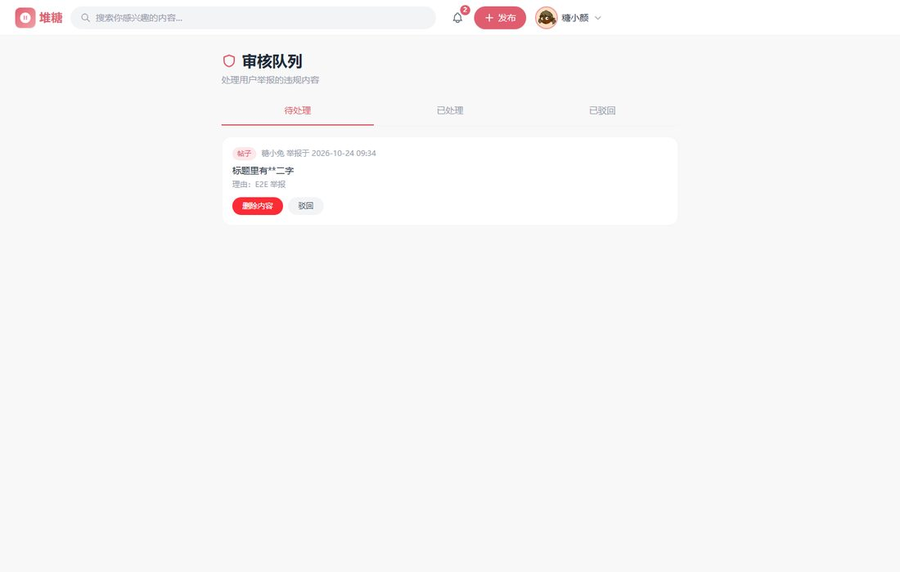
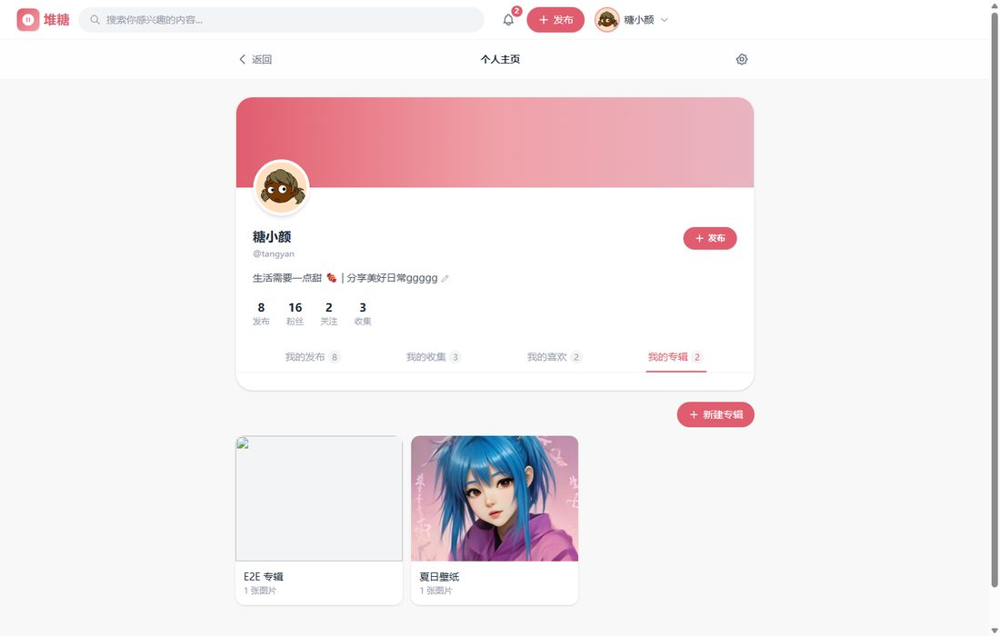
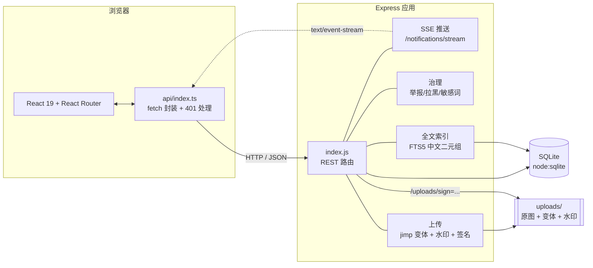

<div align="center">

# 堆糖 · Duitang

**高清图片兴趣社区 — 瀑布流浏览 · 收集 · 关注流 · 内容治理**

一个「能真的跑起来」的图片社区全栈实现：React 19 + Express + SQLite，
**零原生依赖**、**一键验证**、**接口契约自动生成**。

[](https://github.com/kedamano/duitang/actions/workflows/ci.yml)
[](#技术栈)
[](#技术栈)
[-003b57?logo=sqlite&logoColor=white)](#关键设计决策)
[](#测试)
[](LICENSE)

[功能特性](#-功能特性) · [快速开始](#-快速开始) · [架构](#-架构) · [设计决策](#-关键设计决策) · [API](#-api) · [测试](#-测试) · [部署](#-部署)

</div>


---

## 简介

堆糖是一个以图片为核心的兴趣社区。你可以浏览错落瀑布流、把喜欢的图收集进专辑、
关注感兴趣的作者、在评论区楼中楼里讨论、发布自己的图文作品。

这个仓库不是 UI 稿，而是一个**完整可运行的全栈应用**，重点在于把社区产品容易踩坑的地方做对：

- 图片按真实宽高排版 + 多档尺寸变体按需加载，不浪费带宽
- 通知既有 SSE 实时推送，也有轮询兜底，还会按类型与关注关系拦截
- 评论区是楼中楼，但只有一层嵌套，避免无限递归
- 中文搜索用 FTS5 倒排索引，2 个字也能搜到
- 有举报、审核队列、拉黑、敏感词，而不是裸奔上线

> **技术选型的底线是「零原生依赖」**：数据库用 Node 22 内置的 `node:sqlite`，
> 图片处理用纯 JS 的 `jimp`，不需要 `node-gyp`、不需要编译工具链，
> `npm install` 之后就能跑。

---

## ✨ 功能特性

### 浏览与发现

| 功能 | 说明 |
| --- | --- |
| **错落瀑布流** | 按图片真实宽高分配列高，避免等高网格的裁切尴尬 |
| **响应式选档** | 上传时生成 400/800 两档变体，列表用 `srcset` 让浏览器按需选档 |
| **虚拟滚动** | 瀑布流绝对定位 + 视口裁剪，只渲染可见区间（含 600px overscan），长刷 DOM 数量恒定不随翻页增长 |
| **hover 预取** | 卡片悬停 120ms 提前拉取详情，进入详情页直接命中缓存秒开 |
| **深色模式** | 语义色板（CSS 变量）驱动，一键切换并记忆，跟随系统偏好；品牌粉两种模式下保留 |
| **大图灯箱** | 支持 `←` / `→` 翻页、`Esc` 关闭、缩略图切换、**移动端左右滑动切图** |
| **独立分享页** | `/#/pin/<id>` 直达单条帖子，可外部分享（当前为 HashRouter，`#` 路径不被搜索引擎收录；站内分享与直链打开不受影响） |
| **三栏首页** | 左侧「每日精选 / 关注动态 + 分类下拉」竖排导航（平板与手机收进顶栏）、中间内容流、右侧热门话题；12 个画板不再平铺，收进「分类 ▾」图标面板 |
| **整版帖子流** | 每日精选与关注动态按**帖子整版卡片**展示（作者头 + 标题 + 方图网格 + 点赞/收集/更多操作条），贴近堆糖的信息密度；分类画板仍是瀑布流（浏览找图更高效） |
| **分类与标签** | 分类下拉即时切换画板 + `/#/tag/<标签>` 聚合页，卡片标签可点击跳转 |
| **发现页** | `/#/discover` 热门作者（近 30 天互动量）、热门话题、新鲜面孔，缓解关注流冷启动 |
| **真实热搜** | 热搜来自用户实际搜索统计（`search_queries`），不是写死的假数据 |
| **PWA 可安装** | manifest + 图标 + 手写 Service Worker：应用壳离线可开、API/图片 network-first 带离线回落，生产构建自动注册 |

### 创作与组织

| 功能 | 说明 |
| --- | --- |
| **富文本描述** | TipTap 编辑器：加粗/斜体/删除线/小标题/列表/引用/代码/链接 |
| **AI 生图** | Pollinations 免费生成（经代理）；**失败自动换种子重试一次**，再失败给手动重试入口 |
| **多图上传** | 最多 9 张，支持拖拽排序与一键设为封面；**超大图浏览器内先压缩**（canvas 缩到最长边 ≤2560px，透明 PNG 保格式、GIF 保护动画、压大反增则保留原图）；**发布时按钮实时显示「上传 i/n」进度** |
| **服务端草稿箱** | 输入停止 1.2s 自动保存到服务端，换设备继续编辑 |
| **专辑（收藏夹）** | 自建专辑、公开/私密、收藏或发布时归入、专辑详情页 |
| **帖子编辑** | 作者可改标题/描述/画板/标签，图片与尺寸保持不变 |

### 社交与互动

| 功能 | 说明 |
| --- | --- |
| **关注流** | 只看已关注作者 + 自己，未登录/无关注都有对应空状态 |
| **楼中楼评论** | 单层嵌套；回复默认折叠、点击展开、可分页加载 |
| **评论轻量格式** | `**加粗**` / `*斜体*` / `` `代码` `` + `@昵称` 高亮跳转 |
| **@提及** | 被提到的人会收到通知（类型 `mention`） |
| **实时通知** | SSE 长连接推送未读数，断线自动回落 60s 轮询 |
| **通知偏好** | 每类通知可设「开启 / 仅关注的人 / 关闭」，写入前即拦截 |

### 社区治理

| 功能 | 说明 |
| --- | --- |
| **举报** | 帖子/评论/用户均可举报，同一对象只保留一条待处理 |
| **审核队列** | `/#/admin/reports` 管理员可删除违规内容或驳回举报 |
| **拉黑** | 拉黑后对方帖子、评论、关注流内容全部过滤（服务端过滤） |
| **敏感词** | 标题/描述/评论/专辑名命中即打码，词表可配置 |
| **富文本消毒** | 后端 `sanitize-html` 白名单 + 前端 DOMPurify 二次过滤 |

<table>
<tr>
<td width="50%"></td>
<td width="50%"></td>
</tr>
<tr>
<td align="center"><sub>帖子详情：多图切换、互动栏、灯箱</sub></td>
<td align="center"><sub>楼中楼评论：默认折叠、@提及、轻量格式</sub></td>
</tr>
<tr>
<td width="50%"></td>
<td width="50%"></td>
</tr>
<tr>
<td align="center"><sub>TipTap 富文本编辑器：工具栏激活态实时同步</sub></td>
<td align="center"><sub>发现页：热门作者 / 话题 / 新人</sub></td>
</tr>
<tr>
<td width="50%"></td>
<td width="50%"></td>
</tr>
<tr>
<td align="center"><sub>审核队列：管理员处理举报</sub></td>
<td align="center"><sub>个人主页：发布 / 收集 / 喜欢 / 专辑</sub></td>
</tr>
</table>

---

## 🚀 快速开始

### 环境要求

| 依赖 | 版本 | 说明 |
| --- | --- | --- |
| Node.js | **≥ 22** | 需要内置的 `node:sqlite` 模块 |
| npm | ≥ 9 | 或 pnpm / yarn |

### 三步启动

```bash
# 1. 启动后端（首次启动自动建库 + 灌入演示数据）
cd server
npm install
npm run dev            # http://localhost:3001

# 2. 另开终端，启动前端
npm install
npm run dev            # http://localhost:5173
```

打开 <http://localhost:5173> 即可浏览。

### 演示账号

密码统一为 `123456`：

| 用户名 | 昵称 | 说明 |
| --- | --- | --- |
| `tangyan` | 糖小颜 | **管理员**，可进入审核队列 |
| `tangtu` | 糖小兔 | 普通用户 |
| `mochi` | 麻薯小姐 | 普通用户 |
| `lvren` | 旅人阿白 | 普通用户 |
| `gufeng` | 故梦古风 | 普通用户 |

### 端口被占用

```powershell
# 后端换端口
$env:PORT=3002; node index.js
# 前端指向新端口
$env:BACKEND_URL="http://localhost:3002"; npm run dev
```

---

## 🏗 架构



### 数据模型（主要表）

| 表 | 作用 |
| --- | --- |
| `users` | 账号、头像、简介、通知偏好、管理员标记 |
| `posts` | 帖子（`images` / `thumbs` / `sizes` / `images_variants` 平行数组） |
| `post_likes` · `post_collects` | 点赞、收藏 |
| `comments` · `comment_likes` | 评论（`parent_id` 实现单层楼中楼）、评论点赞 |
| `user_follows` · `user_blocks` | 关注、拉黑 |
| `notifications` | 通知（按「接收者+触发者+类型+目标」唯一去重） |
| `albums` · `album_posts` | 专辑与专辑内容 |
| `reports` | 举报与审核状态 |
| `drafts` | 服务端草稿（每人一份） |
| `search_queries` | 搜索词统计（热搜数据源） |
| `post_fts` | FTS5 虚拟表（全文索引） |

---

## 🔍 关键设计决策

这一节记录几个「为什么这样做」，也是这个项目里最容易被做错的地方。

<details>
<summary><b>1. 中文全文检索：为什么不用 FTS5 自带的 trigram 分词</b></summary>

`node:sqlite` 确实支持 FTS5，但：

- **trigram 分词要求查询 ≥ 3 字符**。中文最常用的 `汉服`、`壁纸`、`美食` 都是 **2 字**，
  用 trigram 会直接**搜不到结果**（实测 `MATCH '汉服'` 返回空）。
- **unicode61 不做中文分词**，整段中文会被当成一个 token。

解法：**把中文切成重叠二元组再入库**。

```
入库:  "汉服写真"  →  "汉服 服写 写真"
查询:  "汉服"      →  "汉服"            命中
查询:  "美食探店"  →  "美食 食探 探店"   命中
```

配合 FTS5 的 `unicode61` 分词，既支持 2 字中文查询，又保留倒排索引的查询效率
（不是全表 `LIKE '%kw%'`）。索引覆盖标题 / 描述 / 标签 / 作者昵称 / **画板中文名**
（所以搜「美食」也能找到美食画板的帖子），单字查询自动回落 `LIKE`。

索引在帖子增删改时同步维护；分词规则变更后执行
`node server/scripts/rebuild-search-index.js` 重建。

</details>

<details>
<summary><b>2. 零原生依赖：为什么用 node:sqlite + jimp</b></summary>

社区项目常见的 `better-sqlite3` + `sharp` 组合需要 `node-gyp` / `libvips`，
在 Windows 和 CI 上经常装不上。本项目全部走纯 JS / 内置模块：

| 需求 | 常见方案 | 本项目 | 原因 |
| --- | --- | --- | --- |
| 数据库 | `better-sqlite3` | `node:sqlite`（内置） | 免编译 |
| 图片缩放 | `sharp` | `jimp` | 纯 JS，免 libvips |
| 富文本消毒 | - | `sanitize-html` + `dompurify` | 纯 JS |

代价是 `jimp` 比 `sharp` 慢（单张图 resize 百毫秒级），对图片社区足够用；
换来的是**任何环境 `npm install` 后立即可跑**。

</details>

<details>
<summary><b>3. 通知：去重、撤回、偏好拦截</b></summary>

- **去重**：按「接收者 + 触发者 + 类型 + 目标」唯一，反复点赞/收藏不会堆积红点。
- **撤回**：取消点赞、删除评论时同步删掉对应通知，不留僵尸消息。
- **偏好拦截**：`notify_prefs` 支持三态（`true` / `false` / `"followers"`），
  在**写入通知前**就判定，所以 SSE 也不会推送被关闭的类型。
- **实时 + 兜底**：SSE 长连接推送未读数；`EventSource` 断线自动回落 60s 轮询，
  窗口重新聚焦也会主动刷新。

</details>

<details>
<summary><b>4. 楼中楼：为什么只有一层嵌套</b></summary>

`comments.parent_id` 只允许一层：回复的回复统一挂到**顶层评论**下，
列表接口给顶层评论内嵌前 3 条回复与 `reply_count`。

理由：无限嵌套会导致（a）查询复杂度爆炸、（b）移动端缩进无处安放。
单层 + 「回复 @某人」已经能表达完整语义，主流产品（微博、Instagram）都这么做。

</details>

<details>
<summary><b>5. 安全：两道防线的富文本消毒</b></summary>

| 位置 | 手段 |
| --- | --- |
| 后端写入 | `sanitize-html` 白名单（`p/strong/em/ul/li/a/code/...`），链接强制 `rel="noopener noreferrer"`，`javascript:` 协议剥离 |
| 前端渲染 | `DOMPurify` 再过滤一遍，即使后端被绕过也不会执行脚本 |
| 评论 | **不存 HTML**，只存纯文本 + 行内标记，从根上没有 XSS 面 |
| 上传 | 用 magic bytes 校验真实文件类型（防伪造扩展名），限 10MB |

</details>

<details>
<summary><b>6. 测试隔离：为什么每个测试文件单独起进程</b></summary>

11+ 个测试文件都要 `require('../index')`，但 Node 的模块缓存只会执行一次，
结果**所有文件共用同一个数据库连接**（`DB_PATH` 只有第一个生效），
数据互相污染，甚至触发 `node:sqlite` 的原生崩溃（`0xC0000409`）。

解法：`npm run test:server` 用 `scripts/run-server-tests.mjs` **逐文件独立进程**运行，
每个文件用自己的数据库，运行前清理旧库；原生崩溃自动重试（断言失败不重试）。

</details>

<details>
<summary><b>7. 会话续期：活跃用户不被 7 天硬登出</b></summary>

JWT 固定 7 天有效期，老做法是到期直接登出，体验很差。这里做**滑动续期**：
一个全局中间件检查每个带 token 的请求（含公开接口的可选登录场景），
只要剩余有效期不足 1 天，就用响应头 `X-Refresh-Token` 下发一枚全新的 7 天 token，
前端 `request()` 读到后透明替换 `localStorage`。

- 活跃用户：只要 7 天内来过就不会被登出；
- 长期不活跃者：token 仍会过期需重新登录，**安全边界没有放松**（不做无限续期）。

</details>

<details>
<summary><b>8. 深色模式：语义色板而非 dark: 前缀堆砌</b></summary>

没有给每个元素手写 `dark:bg-xxx`（几百处、易漏、难维护）。做法是把**中性色**
（页面底 / 卡片面 / 边框 / 各级文字）收敛成 CSS 变量语义 token
（`--surface` / `--ink` / `--line` …），`:root` 与 `.dark` 各给一套值，
Tailwind 通过 `@theme inline` 映射成 `bg-surface` / `text-ink` 等类。
一次脚本化替换（27 个文件）即完成迁移，切换只改 `html` 上的 `dark` 类。

品牌粉（`#e05d6f`）**刻意不 token 化**——深浅两色下都保持品牌识别。

</details>

<details>
<summary><b>9. 构建产物 946KB（gzip 286KB）为什么不继续瘦身</b></summary>

sourcemap 实测占比：react-dom 20.6%、react-router 13.8%、自有代码 12.4%、
**TipTap + ProseMirror 全家桶合计约 32%**（编辑器）、tailwind-merge 3.7%、dompurify 3.2%。

结论：
- 大头是**功能本身**（富文本编辑器）与框架，不是垃圾代码；
- 单文件部署（`vite-plugin-singlefile`）天然禁止分包，编辑器按需加载省不下来——
  除非放弃单文件产物，这是部署形态的取舍，不是代码问题；
- 可小优化项：`linkifyjs`（仅链接识别，~64KB）可换更轻实现、
  路由可换 `wouter`（~2KB，省 ~350KB）——**收益有限且引入回归风险，暂不动**。

若未来要真正瘦身：先确认是否保留单文件部署，再评估编辑器懒加载（发布页才拉取）。

</details>

---

## 📡 API

完整的 OpenAPI 3.0 规范在 [`docs/openapi.json`](docs/openapi.json)，
由 `node scripts/gen-openapi.mjs` 从路由元数据生成（**53 个接口**），
前端共享类型在 [`src/types/api.ts`](src/types/api.ts)，两者一致性由单元测试守护。

| 分组 | 端点示例 |
| --- | --- |
| 认证 | `POST /api/auth/register` · `POST /api/auth/login` · `GET /api/auth/me` |
| 帖子 | `GET /api/posts` · `POST /api/posts` · `PUT /api/posts/:id` |
| 互动 | `POST /api/posts/:id/like` · `collect` · `share` |
| 评论 | `GET /api/posts/:id/comments` · `POST` · `POST /api/comments/:id/like` |
| 用户 | `GET /api/users/:id/profile` · `POST /api/users/:id/follow` · `block` |
| 专辑 | `GET /api/albums/:id` · `POST /api/albums` · `POST /api/albums/:id/posts` |
| 通知 | `GET /api/notifications` · `GET /api/notifications/stream`（SSE） |
| 治理 | `POST /api/reports` · `GET /api/admin/reports` · `POST /api/admin/reports/:id/resolve` |
| 上传 | `POST /api/upload`（返回原图 + 变体 + 水印 + 防盗链签名） |

```bash
# 用规范文件生成客户端 / 导入 Postman / Apifox
curl -s http://localhost:3001/api/posts?limit=1 | jq
```

---

## 🧪 测试

| 层级 | 工具 | 用例数 | 命令 |
| --- | --- | --- | --- |
| 前端单测 | Vitest + Testing Library | **231** | `npm test` |
| 后端接口 | Mocha + Supertest | **181**（17 文件） | `npm run test:server` |
| 浏览器 E2E | 原生 CDP 驱动无头 Chrome | **4 套件 / 50+ 断言** | `npm run test:e2e` |
| 类型检查 | TypeScript | - | `npx tsc --noEmit` |

前端单测附带**覆盖率门槛**（`vitest.config.ts` 的 `coverage.thresholds`，按当前实测留 2 个点余量），
低于底线时 `npm run verify` 直接失败，防止测试被悄悄删掉后无人发现。

**一键跑完全部关卡**（含 OpenAPI 生成与生产构建）：

```bash
npm run verify
```

```
──────── 验证结果 ────────
✓ 生成 OpenAPI 规范      0.1s
✓ 类型检查 (tsc)         4.7s
✓ 前端单测 (vitest + 覆盖率门槛)  10.1s
✓ 后端单测 (mocha)      43.7s
✓ 生产构建 (vite build)  9.9s
全部关卡通过
```

E2E 需要先启动前后端，并建议关闭限流（反复登录会触发 auth 限流）：

```powershell
$env:RATE_LIMIT_DISABLED="1"      # 启动后端前设置
npm run test:e2e                  # 全部套件
node scripts/e2e-all.mjs social   # 只跑某一套
```

| E2E 套件 | 覆盖内容 |
| --- | --- |
| `core` | 首页瀑布流、竖排导航与分类下拉、详情、**FTS5 中文搜索**、SSE 未读角标、登录失效引导 |
| `publish` | 富文本编辑器与 XSS 防护、多图切换、服务端草稿、专辑、敏感词打码 |
| `social` | 楼中楼折叠展开、@提及、评论轻量格式、关注流、通知偏好、标签/画板、灯箱 |
| `moderation` | 发现页、举报弹窗、审核队列、拉黑过滤、非管理员越权拦截 |

---

## 🚢 部署

```bash
# 1. 构建前端（单文件产物，便于任意静态托管）
npm run build                  # → dist/index.html

# 2. 配置后端
cp server/.env.example server/.env
```

### 环境变量

| 变量 | 默认值 | 说明 |
| --- | --- | --- |
| `PORT` | `3001` | 后端端口 |
| `JWT_SECRET` | 开发默认值 | **生产必须更换**：`node -e "console.log(require('crypto').randomBytes(32).toString('hex'))"` |
| `FRONTEND_ORIGIN` | 空（仅允许本机） | 允许的跨域来源，逗号分隔 |
| `DB_PATH` | `server/database.sqlite` | SQLite 文件路径 |
| `UPLOAD_DIR` | `server/uploads` | 上传目录 |
| `LOG_LEVEL` | `info` | `trace/debug/info/warn/error` |
| `ADMIN_USERNAMES` | `tangyan` | 管理员用户名，逗号分隔 |
| `SENSITIVE_WORDS` | 内置演示词表 | 敏感词，逗号分隔 |
| `UPLOAD_HOTLINK_PROTECT` | 关闭 | 设为 `1` 后图片需带 HMAC 签名访问 |
| `UPLOAD_REFERER_CHECK` | 关闭 | 设为 `1` 后校验 Referer 白名单 |
| `WATERMARK_TEXT` | `堆糖 duitang` | 水印文案 |
| `RATE_LIMIT_DISABLED` | 关闭 | 设为 `1` 关闭限流（仅开发/测试用） |

> **上线前必做**：更换 `JWT_SECRET`、设置 `FRONTEND_ORIGIN`、把 `server/.env` 排除在版本库外
> （默认已在 `.gitignore`）、把敏感词表换成真实词库、配置数据库定时备份。

### 数据库备份

```bash
npm run backup                    # 快照到 server/backups/，默认保留最近 14 份
node scripts/backup-db.mjs --out /data/bak --keep 30   # 自定义目录与保留数
```

用 SQLite 的 `VACUUM INTO` 生成**在线一致性快照**（WAL 模式下也不阻塞读写），
比直接复制 `.sqlite` 文件可靠。配合系统计划任务（cron / 任务计划程序）每天执行一次即可。

---

## 📁 项目结构

```
.
├── src/                        前端
│   ├── api/                    fetch 封装（JWT 头、401 处理、类型化响应）
│   ├── components/             Header / PostDetail / MasonryGrid / NotificationBell
│   │                           RichTextEditor / RichTextContent / ReportModal / Icons …
│   ├── context/                Auth / Collection / Toast
│   ├── hooks/                  useTrending（热搜聚合，模块级缓存）
│   ├── pages/                  Home / Publish / Profile / Tag / Board / Album / Discover / Admin
│   ├── types/api.ts            前后端共享类型（与 OpenAPI 对应）
│   └── utils/                  normalizePost / mention / richText / searchEvent …
├── server/                     后端
│   ├── index.js                Express 路由
│   ├── database.js             建表 + 轻量迁移
│   ├── search-index.js         FTS5 中文二元组索引
│   ├── upload-guard.js         防盗链签名 + 水印
│   ├── sensitive-words.js      敏感词
│   ├── seed-demo.js            演示数据
│   └── test/                   16 个接口测试文件
├── scripts/
│   ├── e2e/                    E2E 套件（harness + core/publish/social/moderation）
│   ├── e2e-all.mjs             跑全部 E2E
│   ├── verify-all.mjs          一键质量关卡
│   ├── run-server-tests.mjs    后端测试隔离运行器
│   └── gen-openapi.mjs         生成 OpenAPI 规范
├── docs/
│   ├── openapi.json            OpenAPI 3.0 规范（自动生成）
│   └── screenshots/            README 截图
└── .github/workflows/ci.yml    CI：安装依赖 → npm run verify
```

---

## 🤝 贡献

欢迎提 Issue 和 PR。提交前请确保：

```bash
npm run verify      # 类型检查 + 前后端单测 + 构建 全部通过
npm run test:e2e    # 改动涉及界面时补跑 E2E
```

- 新增接口请同步更新 `scripts/gen-openapi.mjs` 的路由元数据与 `src/types/api.ts`
- 新增页面/关键交互请加 `data-testid`，便于 E2E 稳定断言
- 提交信息建议用 `feat:` / `fix:` / `test:` / `chore:` 前缀

---

## 📄 License

[MIT](LICENSE)

> 项目名为致敬「堆糖」的练习作品，与堆糖官方无关；演示图片来自公开图源，仅用于技术演示。
